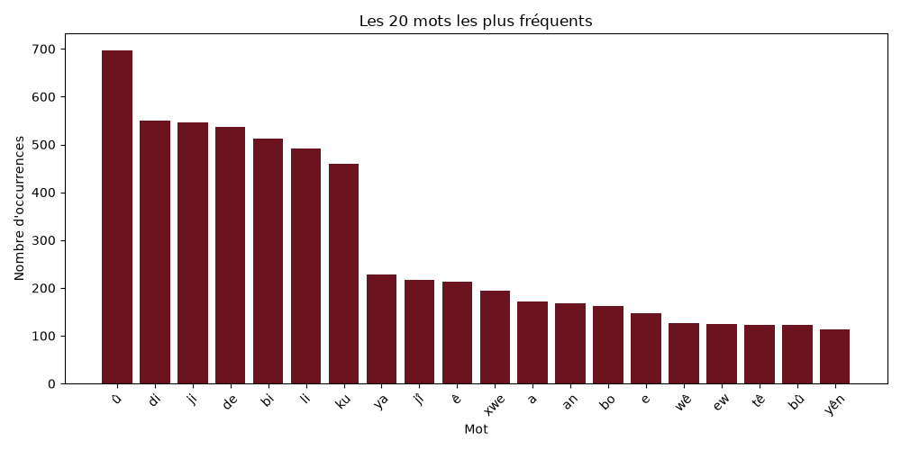
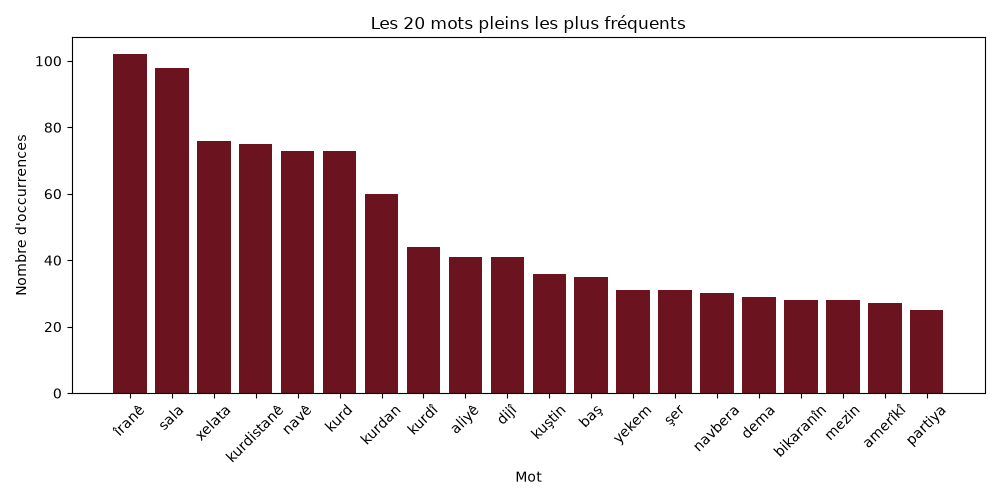
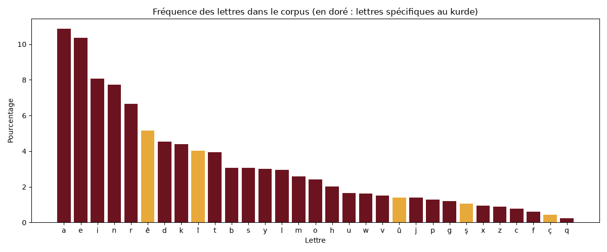
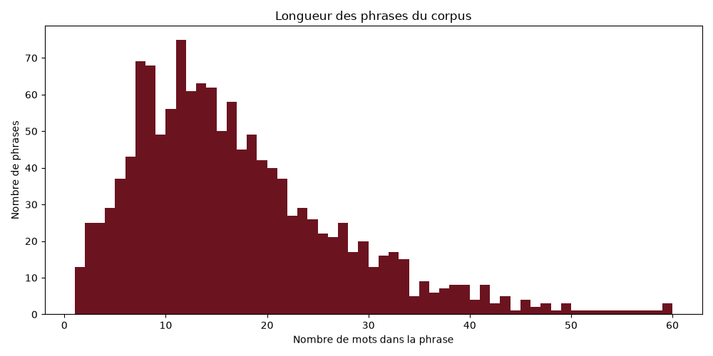

#Analyse d'un corpus kurmancî

Constitution, nettoyage et analyse statistique d'un corpus de textes en kurmancî (kurde du Nord), à partir de Wikipédia en kurde.

Le kurmancî est une langue peu dotée : il existe peu de ressources numériques pour l'étudier et le traiter automatiquement. Ce projet construit un petit corpus et en décrit les caractéristiques : vocabulaire, lettres et phrases. Il sert aussi de base à de futurs outils (générateur d'exercices et de dictées, détection d'emprunts, identification de langue).

## Le corpus en chiffres

| | |
|---|---|
| Source | Wikipédia en kurmancî (ku.wikipedia.org) |
| Articles | 50 articles tirés au hasard, de plus de 100 mots |
| Lettres analysées | environ 108 000 |
| Phrases analysées | 1 342 |

## Démarche

Le projet suit les étapes classiques d'une chaîne de traitement en TAL. Chaque étape est un programme Python.

| Étape | Programme | Rôle |
|---|---|---|
| 1. Récupération | `recuperer.py` | Télécharge 50 articles au hasard via l'API de Wikipédia |
| 2. Nettoyage | `nettoyer.py` | Retire les titres, les lignes vides, les formules et les lignes non kurdes |
| 3. Tokenisation | `tokeniser.py` | Découpe le texte en mots et en phrases |
| 4. Analyse | `analyser.py` | Calcule les fréquences et produit les graphiques |

Les textes d'origine (`donnees/`) ne sont jamais modifiés : les versions nettoyées sont écrites dans `propre/`, et les résultats dans `resultats/`.

## Choix méthodologiques

Chaque règle de nettoyage a été ajoutée après avoir observé un problème réel dans les données.

Récupération. Beaucoup d'articles de Wikipédia en kurde sont des ébauches très courtes. Seuls les articles de plus de 100 mots ont été gardés : le corpus n'est donc pas un échantillon parfaitement représentatif de toute la Wikipédia kurde.

Nettoyage.
- Les titres de sections (`== … ==`) et les lignes vides sont supprimés.
- Un article de mathématiques contenait des formules écrites en LaTeX. Les lignes contenant une barre oblique inversée (`\`) sont supprimées.
- Certains articles contiennent des listes en anglais (titres, catégories de prix). Une ligne n'est gardée que si elle contient au moins une lettre propre au kurmancî : ê, î, û, ç ou ş. L'analyse des lettres confirme la solidité de cette règle : ces cinq lettres représentent environ une lettre sur huit dans le corpus.

Tokenisation.
- Un mot est une suite de lettres : la ponctuation et les chiffres sont retirés, et le texte est mis en minuscules.
- Seuls les mots écrits entièrement avec les 31 lettres de l'alphabet kurmancî sont gardés. Ce filtre élimine les mots en alphabet arabo-persan (par exemple le nom original de Chiraz, `شیراز`) et les mots étrangers contenant des lettres comme é, ü ou ö.
- Les mots d'une seule lettre sont écartés, sauf ceux qui existent en kurmancî (û, ê, a, e, î). Cette règle supprime les variables mathématiques comme le n de `P(n)`, repéré grâce à un concordancier.
- Les phrases sont découpées aux signes `.`, `!` et `?`.

Analyse des mots.
- Une liste de mots outils a été établie à la main : prépositions, conjonctions, pronoms, particules d'ézafé, et formes très fréquentes des verbes kirin (faire), hatin (venir) et bûn (être). Il n'existe pas de liste de référence pour le kurmancî : ces choix sont ceux d'une locutrice native, et peuvent être discutés.
- Un mot n'est retenu dans l'analyse des mots pleins que s'il apparaît dans au moins 3 articles (fréquence documentaire). Cette règle générale écarte les mots propres à un seul article, notamment des mots étrangers comme of ou des noms propres isolés, sans avoir à les nommer un par un.

## Résultats

### 1. Les mots les plus fréquents : la loi de Zipf



Sans filtre, les mots les plus fréquents sont tous des mots outils : û (et), puis les prépositions de base di, ji, bi, li, la postposition de, la conjonction ku et les particules d'ézafé ê, a, ya, yên. C'est une illustration de la loi de Zipf : dans toutes les langues, quelques mots grammaticaux sont extrêmement fréquents, tandis que la grande majorité des mots sont rares.

Ce classement reflète la grammaire du kurmancî telle que la décrit Haig (2018) : le système de prépositions di, ji, bi, li, souvent associées à des postpositions comme de, et l'ézafé, qui relie le nom à ses compléments.

### 2. Les mots pleins : les thèmes du corpus



Une fois les mots outils retirés, les thèmes du corpus apparaissent :
- la région : Îranê, Kurdistanê, kurd, kurdan, kurdî, amerîkî ;
- l'histoire politique et les conflits : şer (guerre), kuştin (tuer), dijî (contre), partiya (le parti), navbera (entre) ;
- le temps : sala (l'année), dema (le moment), yekem (premier).

On remarque aussi que beaucoup de ces mots portent une marque grammaticale : Îranê et Kurdistanê sont au cas oblique, navê et aliyê portent l'ézafé. Une lemmatisation (ramener chaque mot à sa forme de base) permettrait de regrouper kurd, kurdan et kurdî.

Ces résultats sont à interpréter avec prudence : avec 50 articles, un seul long article peut peser lourd. Le mot xelata (le prix), par exemple, vient en grande partie d'un article consacré à une cérémonie de récompenses.

### 3. La fréquence des lettres



| Observation | Chiffre |
|---|---|
| Lettres les plus fréquentes | a (10,9 %) et e (10,4 %) |
| Part des voyelles (a, e, i, ê, î, o, u, û) | environ 44 % |
| Part des lettres propres au kurde (ê, î, û, ç, ş) | environ 12 % |
| Lettre la plus rare | q (0,2 %) |

- Le kurmancî écrit est très riche en voyelles : a et e représentent à elles seules plus d'une lettre sur cinq.
- ê est la 6e lettre la plus fréquent (5,2 %), devant d, k ou t. C'est la lettre de l'ézafé (navê, bajarê) et de nombreuses terminaisons de l'oblique (Îranê). La grammaire se lit directement dans les fréquences.
- q est la lettre la plus rare. Elle apparaît surtout dans des mots d'origine arabe (qelem), ce qui en fait un indice intéressant pour la détection d'emprunts.

### 4. La longueur des phrases



| Mesure | Valeur |
|---|---|
| Nombre de phrases | 1 342 |
| Longueur moyenne | 17 mots |
| Longueur médiane | 14 mots |
| La moitié des phrases | entre 9 et 22 mots |

- La moyenne (17) dépasse la médiane (14) : quelques phrases très longues tirent la moyenne vers le haut. L'histogramme montre un pic entre 7 et 15 mots, puis une longue traîne vers les phrases longues, une forme typique dans toutes les langues.
- Répartition par catégorie : 309 phrases courtes (8 mots ou moins), 650 moyennes (9 à 20 mots) et 383 longues (plus de 20 mots). Ces catégories pourront servir à choisir des phrases adaptées au niveau d'apprenants, par exemple pour générer des dictées.

## Limites

- Taille et représentativité : 50 articles, uniquement de plus de 100 mots, et un seul genre de texte (encyclopédique). Les résultats ne décrivent pas le kurmancî dans son ensemble.
- Mots étrangers : un mot étranger isolé au milieu d'une phrase kurde n'est pas détecté, s'il s'écrit avec l'alphabet latin.
- Découpage en phrases : les abréviations (Dr., hwd.) et les numérotations créent de fausses fins de phrase, d'où quelques « phrases » d'un seul mot. À l'inverse, les listes sans point produisent des phrases très longues (jusqu'à 141 mots).
- Mots outils : la liste a été établie à la main et reste discutable.
- Formes fléchies : sans lemmatisation, les différentes formes d'un même mot (kurd, kurdan, kurdî) sont comptées séparément.

## Pistes d'amélioration

- Agrandir le corpus et diversifier les sources (presse, littérature, contes)
- Lemmatiser les mots, pour regrouper les formes d'un même mot
- Améliorer le découpage en phrases (gestion des abréviations)
- Comparer avec un corpus soranî, grâce à Wikipédia en soranî (ckb.wikipedia.org)

## Utilisation

Il faut Python 3 avec les bibliothèques `requests`, `pandas` et `matplotlib`. Depuis le dossier du projet, lancer dans l'ordre :

```
python recuperer.py
python nettoyer.py
python analyser.py
```

`recuperer.py` tire des articles au hasard : un nouveau lancement produit donc un corpus différent. Les réglages (`NB_ARTICLES`, `MOTS_MINIMUM`, `MIN_ARTICLES`) se trouvent en haut des programmes.

## Sources

- Textes : [Wikipédia en kurmancî](https://ku.wikipedia.org), sous licence [CC BY-SA 4.0](https://creativecommons.org/licenses/by-sa/4.0/deed.fr). Les textes du dossier `donnees/` restent sous cette licence.
- Haig, Geoffrey. « Northern Kurdish (Kurmanjî) ». https://doi.org/10.1515/9783110421682-004

## Autrice

Hülya Özen (Ezda), étudiante en Master de Traitement Automatique des Langues à l'INALCO. Portfolio : [ezda13.github.io](https://ezda13.github.io)

